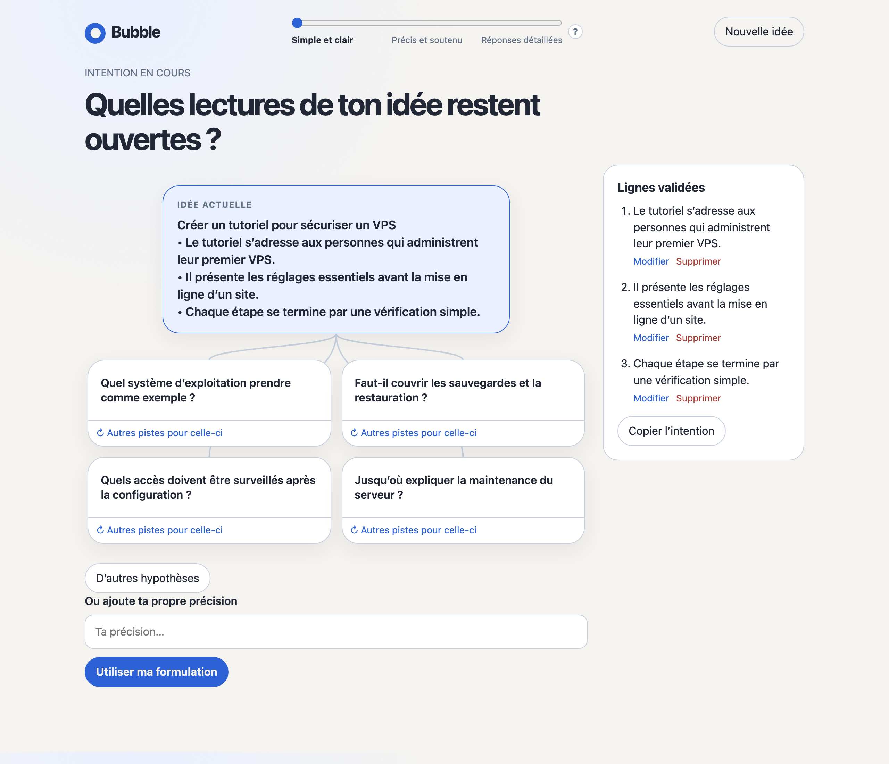

# Bubble

**Faites grandir une idée, une décision à la fois.**

Bubble transforme une idée brute en intention assez claire pour passer à l’action. Dans un graphe interactif, explorez les questions que soulève votre idée, choisissez les pistes utiles et validez chaque nouvelle ligne vous-même. Vous gardez la main sur le résultat, tandis que les détails d’exécution restent ouverts.

## Aperçu de l’interface



*Session de démonstration autour d’un tutoriel pour sécuriser un VPS.*

## Démarrer sur Mac

Il vous faut **Python 3** et une version récente du **Codex CLI** (0.156.1 ou plus récente, pour GPT-6 Sol) installés sur votre Mac. Suivez le [guide officiel du Codex CLI](https://learn.chatgpt.com/docs/codex/cli) pour l’installer, puis lancez `codex` une première fois dans le Terminal et connectez-vous avec votre compte ChatGPT. Vous pouvez vérifier la connexion avec `codex login status`.

1. Téléchargez ce projet et gardez son dossier complet.
2. Dans ce dossier, double-cliquez sur **Bubble.app**.
3. La page Bubble s’ouvre dans votre navigateur. Saisissez une idée, puis cliquez sur **Explorer l’idée**.

Si vous préférez le Terminal, placez-vous dans le dossier du projet et lancez :

```bash
python3 scripts/bubble.py
```

Le serveur écoute uniquement sur votre Mac, à l’adresse `http://127.0.0.1:8766/`. Gardez-le ouvert pendant votre exploration.

Après un double-clic sur **Bubble.app**, fermer l’onglet ou le navigateur n’arrête pas le serveur Python : il reste en arrière-plan. Pour l’arrêter, ouvrez **Moniteur d’activité**, cherchez `Python`, sélectionnez le processus qui exécute `scripts/bubble.py`, cliquez sur le bouton d’arrêt (×), puis choisissez **Quitter**. Si plusieurs processus Python apparaissent, la commande `pgrep -fl 'scripts/bubble.py'` dans le Terminal affiche le numéro (PID) de celui de Bubble ; comparez-le à la colonne **PID** du Moniteur d’activité. Si vous avez lancé Bubble dans le Terminal avec la commande ci-dessus, revenez à ce Terminal et utilisez `Ctrl+C`.

## Une idée, une ligne à la fois

Par exemple, partez de : « Créer un tutoriel pour sécuriser un VPS ».

1. Bubble propose des questions ou des interprétations possibles, sans nombre fixé à l’avance.
2. Cliquez sur une question pour afficher des pistes. Vous pouvez demander d’autres pistes, ou remplacer seulement celle qui ne vous convient pas.
3. Si une piste exprime déjà votre choix, validez-la avec la coche. Sinon, cliquez dessus pour la modifier ou demander une reformulation.
4. Chaque ligne validée enrichit l’idée et sert de point de départ aux propositions suivantes. Bubble vous indique quand l’intention semble assez claire pour commencer ; vous pouvez alors la copier ou continuer à l’affiner.

Un curseur règle le style des prochaines propositions : **Simple et clair** (par défaut), **Précis et soutenu**, ou **Réponses détaillées**.

## Comment Bubble utilise Codex

La page parle à un petit serveur Python local. Pour générer les questions et les pistes, ce serveur appelle **Codex CLI** avec **GPT-6 Sol** par défaut. Vous pouvez choisir un autre modèle en définissant `BUBBLE_MODEL` avant de lancer le serveur. Bubble ne contient aucune clé API : la connexion à Codex est gérée par le CLI, hors de ce dépôt.

Votre idée et vos lignes validées sont conservées dans le stockage local du navigateur que vous utilisez. Elles ne sont pas synchronisées entre navigateurs ou ordinateurs. Les générations envoyées à Codex sont des appels distincts de vos conversations dans l’application Codex.

## Dans le projet

- `Bubble.app` : lanceur macOS à ouvrir depuis ce dossier ; il démarre le serveur Python.
- `scripts/bubble.py` : serveur local et appels au Codex CLI.
- `assets/index.html` : interface du graphe et état conservé dans le navigateur.
- `assets/response.schema.json` : format attendu pour les propositions générées.
- `SKILL.md` : consignes du skill Bubble pour Codex.

Le lanceur macOS utilise les fichiers de ce dossier : conservez-les ensemble. Sur Linux, lancez directement `python3 scripts/bubble.py` après avoir installé Python 3 et connecté le Codex CLI.
